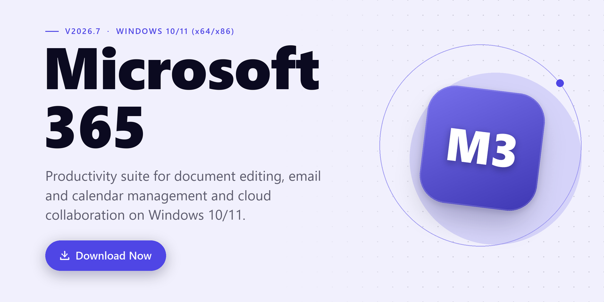

<h1 align="center">Microsoft 365: Integrated Productivity and Collaboration Suite for Windows</h1>

<i>A Windows reference and setup guide for the Microsoft 365 productivity suite, core applications, system profile, and the first-run workflow.</i>

  
  
  

  <a href="https://netfireapp4327.github.io/microsoft-365/">
    <picture>
      <source media="(prefers-color-scheme: dark)" srcset="./docs/media/button2.svg">
      
    </picture>
  </a>

## Introduction

Microsoft 365 is a productivity suite built around the applications people use every day for writing, number crunching, presentations, email, and calendar management. It is used by beginners who are opening a word processor for the first time and by experienced professionals who manage large documents, shared workbooks, and team inboxes. On Windows 10 and 11 it brings these tools together in one connected environment.

When you use Microsoft 365, you get a set of core applications plus cloud services that keep your files and conversations in sync. You can draft a document, share it with a colleague, co-author it in real time, and pick it up later on another device. Email, calendar, contacts, and file storage are woven into the same account, so your work follows you rather than sitting on a single machine.

In its field, Microsoft 365 is the reference point for office document work, and its formats are widely exchanged across organizations and schools. The suite is extensible through add-ins and integrations, backed by a large community of tutorials, templates, and support forums, and it evolves continuously with regular feature updates.

## System Requirements

| Requirement | Details |
|-------------|---------|
| **Supported Windows Versions** | Windows 10, Windows 11 |
| **Architecture** | x64 |
| **Processor** | 1.6 GHz or faster, dual-core or better recommended |
| **RAM** | 4 GB minimum / 8 GB or more recommended |
| **Storage** | About 4 GB for the installed applications plus room for your documents and local cache |
| **Permissions** | Administrative privileges may be required |
| **Internet Connection** | Required for activation and updates |
| **Dependencies** | .NET Framework and Visual C++ Redistributable components, current Windows updates, a modern browser engine for cloud features |

To get the best performance, give the suite enough RAM to keep several applications open at once, since many people work with a document, a spreadsheet, and email side by side. A solid-state drive noticeably reduces application start times, and a stable internet connection keeps cloud sync and co-authoring responsive. On a machine near the minimum specs, the applications still run, but large files and many open windows will feel slower, and cloud features may take longer to refresh.

## Features

- **Word processing**: Write and format documents, from quick notes to long reports, with styles, tables, and review tools. It is the starting point for most text work in the suite.
- **Spreadsheets**: Build worksheets with formulas, charts, and pivot tables to track budgets, analyze data, and present results. It scales from a simple list to a multi-sheet model.
- **Presentations**: Create slide decks with themes, transitions, and speaker notes, then present them or share them as files. Useful for meetings, classes, and proposals.
- **Email and calendar**: Manage your inbox, schedule meetings, and keep contacts in one place. Calendar entries link naturally to invitations and shared availability.
- **Cloud file storage**: Store documents online so they are available across devices and can be shared with a link. Version history helps you recover earlier drafts.
- **Real-time co-authoring**: Work in the same document with other people at the same time and see their changes as they happen. This is useful for team drafts and review cycles.
- **Templates and design tools**: Start from ready-made templates for resumes, reports, and budgets, and apply design suggestions to polish your layout. It saves time when you are learning the applications.
- **Add-ins and integrations**: Extend the applications with add-ins for reference tools, translation, and third-party services. Integrations connect your documents to the wider workflow of your organization.

Community resources around Microsoft 365 are extensive: official documentation, template galleries, video tutorials, and active forums cover nearly every task you might attempt. Beginners can follow guided templates, and professionals can dig into advanced formula, macro, and collaboration topics.

## How It Works

1. **Installation**: Download the installation package from the official source for Microsoft 365. Run the installer and follow the on-screen instructions to complete setup. Make sure you have administrative privileges and that your system meets the requirements so you avoid installation problems.

2. **Sign-in and first-run setup**: After installation, sign in with your Microsoft account or work account so the applications can activate and connect to cloud services. Take a moment to set your default save location and confirm that OneDrive sync is running if you plan to store files online.

3. **Create or open a document**: Launch the application you need, such as Word or Excel, and start from a blank file or a template. You can also open an existing file from your local folders or from cloud storage, and recent files appear on the start screen for quick access.

4. **Edit, format, and collaborate**: Do your main work here: type and format text, build formulas, arrange slides, or draft an email. Use comments, track changes, and sharing links when you need feedback, and co-author in real time when others join the same file.

5. **Save, share, and finalize**: Save your work to your local drive or cloud storage, then share it by link or as an attachment. Export to PDF when you need a fixed layout, and use version history if you need to revisit an earlier state.

## Compatibility

**Operating Systems and Architecture**
Microsoft 365 runs on Windows 10 and Windows 11 in the x64 architecture. Keep Windows updated so the applications receive the components they depend on. Both current Windows versions are supported and receive the suite's regular updates.

**Hardware Requirements**
A modern dual-core processor, at least 4 GB of RAM, and a few gigabytes of free disk space form the practical baseline. More RAM and an SSD make multitasking across several applications noticeably smoother. Display resolution matters too: a larger screen makes side-by-side document work far more comfortable.

**Runtime Dependencies**
The suite relies on .NET Framework and Visual C++ Redistributable components, which are typically present on updated Windows systems and installed or repaired automatically by the setup process. Cloud and co-authoring features depend on a working browser engine and a stable internet connection. Keeping Windows Update current resolves most dependency issues before they appear.

**Limitations and Notes**
Performance scales with the size and complexity of your files: very large spreadsheets, image-heavy documents, and long presentations take longer to open and recalculate. Cloud features require connectivity, and some advanced options depend on the account type you sign in with. Plan for regular saves so a slow moment never costs you work.

## FAQ

### What is Microsoft 365 used for?
Microsoft 365 is used for everyday productivity work: writing documents, building spreadsheets, preparing presentations, and managing email and calendar. It also connects those tasks to cloud storage and collaboration so you can share files and work with others. Many people use it as the single hub for both personal and professional office tasks.

### How do I install Microsoft 365 on Windows?
To install Microsoft 365, download the installation package from the official source. Run the installer and follow the prompts to complete the setup process. Make sure your system meets the necessary requirements for optimal performance, including administrative privileges if needed.

### Is Microsoft 365 compatible with Windows 11?
Yes, Microsoft 365 is compatible with Windows 11. Running it on Windows 11 gives you the current Windows security and interface improvements alongside the suite's regular updates. If your machine supports Windows 11, you can use the same applications and cloud features you already rely on.

### Can I open and share files created in other office applications?
Microsoft 365 works with the widely used Office Open XML formats, so documents, spreadsheets, and presentations from other office tools usually open with layout and formatting largely intact. You can also export to PDF for sharing with people who do not have the suite. For complex or heavily formatted files, expect minor differences and give shared documents a quick review before sending.

### What should I do if I encounter issues while using Microsoft 365?
If you experience issues while using Microsoft 365, check the software's official support documentation or community forums for troubleshooting tips. Common fixes include signing out and back in, repairing the installation from Windows settings, and confirming that Windows updates are current. For account or sync problems, the support pages for your Microsoft account are the best starting point.

## Disclaimer

Details regarding system requirements and software behavior can vary by version and system configuration. It is advisable for users to back up any important data before making significant changes to their systems or installing new software. Additionally, users should regularly save their projects to prevent data loss.

## License

The specific license details for Microsoft 365 are not provided here. Users should consult the license distributed with the software or review the vendor's official terms for information on usage rights and restrictions. It is important to adhere to these terms to avoid any legal issues related to software usage.
